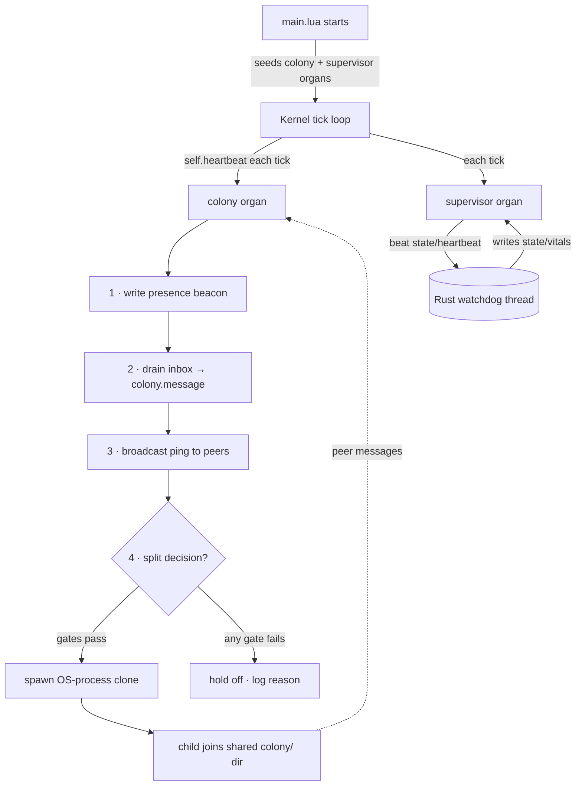
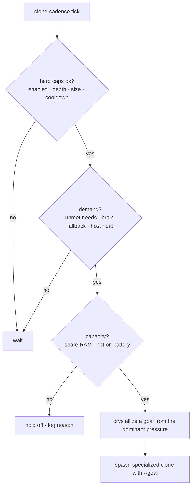

# EvoLua — a self-evolving Lua organism

🇬🇧 English · [🇹🇷 Türkçe](README.tr.md)

EvoLua is an experimental, self-contained "digital organism." It **perceives** its host
environment (per-process CPU/RAM, OS error logs, the filesystem), builds an entity-based
**world model**, **makes sense** of the situation (optional embedded LLM + BM25 RAG, with a
rule-based fallback), and **acts** within an autonomy ladder — growing its own plugins
("organs") under a genuine **genetic system** (typed-rule genomes, honest fitness,
quality-diversity), **replicating into a colony** of communicating processes, **acquiring
purpose** for its offspring, and reporting back. It ships as a single self-contained binary.

> **The core insight that shapes everything:** the Rust host never changes, and `lua/core/`
> is an immutable contract. New capability is *always* a new `.lua` file — never an edit to
> the kernel. The organism writes those files itself at runtime from genome blueprints.

The only deliberate exception is a thin host-side **supervisor** ("brainstem") that observes
the organism's vitals and feeds them back — it watches, it never steers (see below).

> **Fully standalone.** `evolua/` is its own detached Cargo workspace (note the empty
> `[workspace]` table in `Cargo.toml`); it neither joins nor affects any parent workspace.

---

## Quick start

```bash
# Build the single binary (Lua organism is embedded via rust-embed; mlua 5.4 vendored).
cargo build --release                                   # default: ~6 MB, NO model bytes — the brain is
                                                        # found/downloaded/streamed at runtime (llm+acquire+remote)
cargo build --release --no-default-features             # rules-only (no LLM runtime at all)
cargo build --release --features embed_smol             # + bake a 135M model in (offline hosts only, +140 MB)
cargo build --release --features gpu-metal              # macOS GPU backend for the local brain

./target/release/evolua --ticks 60 --tick-seconds 0.2        # bounded fast demo
./target/release/evolua --goal "watch and report errors"     # directed mode
./target/release/evolua --clone --clone-ignore-battery       # let it grow a colony
./target/release/evolua                                      # lives indefinitely
./target/release/evolua --help                               # all flags
```

**Run without building** — a stock `lua` (5.3+) runs the organism directly; the host is
optional:

```bash
lua lua/main.lua --ticks 60 --tick-seconds 0.2
lua lua/main.lua --goal "log filesystem changes"
```

> In plain-Lua mode, redirect the data home by injecting it as a global (the env var is only
> read in binary mode): `lua -e "EVOLUA_HOME='/path'" lua/main.lua`.

### Where the brain comes from (and the binary stays small)

The binary carries **no model**. At birth the organism picks a brain in this order and keeps
**failing over** between them for the rest of its life:

1. **Online service, free tiers first** (`--llm-api auto`, the default): the first provider whose
   key is in the environment — `ollama` (a local server, no key) → `groq` → `cerebras` → `gemini`
   → `openrouter` (free model) → `mistral` → `github` → `huggingface` — then the **keyless** public
   endpoint (`pollinations`), then paid `openai` / `anthropic`. Keys are read from the usual env
   vars (`GROQ_API_KEY`, …) **or from a one-line file `keys/<provider>`** in the data home, which a
   running organism picks up without a restart. Any OpenAI-compatible URL works too
   (`--llm-api https://host/v1`, `anthropic+URL` pins the Anthropic wire format).
2. **A GGUF already on the host** (`core/modelfind.lua`): Ollama's blob store, LM Studio, the
   Hugging Face cache, llama.cpp caches, `--model-dir`. The largest coder/instruct model that fits
   the RAM budget wins.
3. **Download sized to the host**: a pinned ladder (Qwen2.5-Coder-Instruct 0.5B → 1.5B → 3B → 7B,
   url + sha256) through the autonomy ladder; hot-swapped in when it lands, never re-downloaded.
4. **Rules** — always there.

**Failover:** three consecutive online failures (blocked network, quota, outage; `401/402/403`
immediately) put the service in a backoff window; the model manager then finds or downloads a
local brain so the organism keeps thinking, probes the service on the model-check cadence, and
switches back when it answers — freeing the local model's RAM. No key anywhere? It writes
`approvals/api-key-wanted.md` (free providers, where a key comes from, where to drop it) and
carries on with rules / the local model. No provider lets a program sign itself up, so that step
stays human.

---

## What it can do

| Phase | Capability |
|---|---|
| **1 · Sharp perception** | per-process CPU/RAM (`proc_top`), OS crash/error logs (`proc_errors`), an entity-based **world model**, rule-based situational reports |
| **2 · Decision brain** | an LLM **interprets** a whole-system snapshot — an **online service (free tiers first, keyless fallback)**, a GGUF **found on the host**, or one **downloaded sized to the RAM**, with automatic **failover** between online and local; learns from its own experience via a fitness-weighted **BM25 RAG**; falls back to rules when nothing resolves |
| **3 · Autonomy + curiosity** | the **L0–L4 ladder** (learn → report → notify → suggest → act), a file-based **approval inbox**, safe-list + reversibility + audit log, `curiosity`-driven active exploration |
| **4 · Meta-evolution** | probes the host (`hostcaps`) and climbs a pinned **model ladder** when the brain is a bottleneck and there's spare capacity; download + checksum + hot-swap + rollback; frees the local model when the host shrinks or the online brain is back |
| **6 · Synthesis — the brain writes organs** | templates are only the *floor*: the `synth` organ turns a goal or an unhandled stimulus into a one-sentence technical brief, **runs the real commands** and shows their output to the model, has it write a whole new organ, **pre-flights** the parser against those real lines, installs it, and lets honest fitness + report value select — failures feed the next attempt ("don't repeat this approach") |
| **5 · Colony, supervisor, purpose, exploration** | **self-replication** into a colony of communicating processes — across **machines** too with `--mesh` (LAN discovery, seeds for Tailscale/WAN); an intelligent **when-to-split** decision (load + capacity); a host-side **supervisor** ("brainstem"); **goal acquisition** — offspring born specialized to a crystallized purpose, with the colony learning which purposes pay; and **environment exploration** — the organism scouts the host and grows its own senses |

Phases 1–4 are the original organism; **Phase 5 is the colony/supervisor/purpose layer**
documented in depth in [docs/COLONY.md](docs/COLONY.md).

---

## Phase 5 at a glance — colony, supervisor, purpose

### Program flow



### Self-replication (opt-in: `--clone`)

A single seeded `colony` organ gives the organism a sense of **siblings**. Through a shared
filesystem dir `$EVOLUA_HOME/colony/`, each instance writes a presence beacon, drains its
mailbox (emitting a `colony.message` stimulus per message), and pings live peers — the same
"file dance" idiom as the approval inbox. With `--clone` it can spawn **real OS-process
clones** of itself, **triply bounded so it can never fork-bomb**: clone depth
(`clone_max_generation`), colony size (`clone_max_peers`), and a colony-wide cooldown lock.
Children are **mortal** (`clone_child_ticks`) and launched `--no-clone` — only the root
divides (a star colony). The safety caps live in `config.lua`, **not in genes**, so mutation
can tune the cadences but never loosen the bounds.

### When to split is a decision (not just "if there's room")



Mirroring the model ladder's "bottleneck + spare capacity" rule, the colony divides only
under genuine **load** — unmet needs (bus `unhandled_streak`), reasoner brain-bottleneck
(`llm_fallback` rate), or host **heat** (hot/erroring processes) — and only when the host has
**capacity** (spare RAM, not on battery). `--clone-eager` bypasses the gate; `--clone-ignore-battery`
drops just the power guard. (On macOS the system-wide `metric.cpu` sensor is silent —
sys_metrics is `/proc`-based — so "compute pressure" comes from the per-process world model.)

### Goal acquisition — offspring are born with a purpose

A clone is not a generic copy. At split time the colony **crystallizes a goal** from what the
parent is actually living through and passes it as `--goal`, so the child boots **directed**
and grows exactly that niche's organs:

- **explore** — the most chronically unhandled stimulus → fill the gap
- **exploit** — the highest-fitness organ's niche → deepen what pays
- **portfolio** — alternate between the two (default)

Thus an aimless free-mode root **differentiates its offspring into purpose-directed lineages**
over time. Each split is recorded in `colony/lineage.log` (the purpose ledger).
`--clone-generalist` restores plain copies.

And it **learns which purposes pay** (S4, `purpose_learn`): each child harvests how well its
goal paid off into `colony/outcomes/`, and the root then crystallizes via a **bandit over
goals** — favoring goals whose past children earned the most reward, trying each new goal once
(optimistic prior), and periodically probing the current gap. So the colony evolutionarily
keeps valuable purposes. See [docs/COLONY.md](docs/COLONY.md#s4--selecting-valuable-purposes-a-bandit-over-goals).

### Environment exploration — the organism grows its own senses

Beyond the per-process `curiosity` sensor, a seeded `explorer` organ **wanders the host** —
filesystem directories, log files, listening network ports, **installed commands/tools on
`$PATH`** (so it learns what the host can do — `git`, `docker`, `python`, compilers, …), and
system facts — gated by `curiosity`. Its key effect is **perception expansion**: when it discovers an active directory
or log, it appends it to `watch_dirs` / `watch_logs`, so the existing `fswatch` / `logwatch`
sensors start perceiving it on the next tick. New perception → new stimuli → organ growth →
and, through the colony, **new purposes**. So exploration is the front-end that generates the
environmental diversity that goal-acquisition then exploits. It explores outward (its own data
home and huge/VCS dirs like `target/`/`.git` are skipped) within `explore_roots` (default: the
data home + cwd; widen with `--explore-root`). `--no-explorer` / `--no-explore-expand` disable it.

### The host-side supervisor ("brainstem")

The one deliberate exception to "all behavior lives in Lua": a background thread the Rust
host spawns (`src/supervisor.rs`). Because mlua runs the organism in-process on the main
thread, this watch lives on its own thread and talks to the organism only through the
filesystem. It is **supervision, not control**: it observes liveness (the `state/heartbeat`
the Lua `supervisor` organ beats each tick) and writes coarse vitals (`stall`, `self_rss_mb`,
`colony_procs`) to `state/vitals`. The Lua `supervisor` organ reads those back and emits a
`host.vitals` stimulus so the *evolvable* layer decides what to do — the host never caps,
kills, or steers evolution. The single hard reflex (process exit on a prolonged stall) is
**opt-in and off by default** (`EVOLUA_WATCHDOG_KILL=1`).

---

## Evolution engine — how organs actually evolve

Underneath the phases, the evolver is no longer a numeric-parameter tuner over fixed
templates — it is a genuine genetic system. (Design rationale + verification:
[docs/ROADMAP.md](docs/ROADMAP.md#evolution-engine-enrichment).)

| Mechanism | What it does |
|---|---|
| **Honest fitness** | reward is derived from *observable bus facts* — filling a starved stimulus (surprise) ÷ co-handlers (anti-redundancy sharing) − measured cost (parsimony) — **not** the number an organ declares about itself. Breaks reward-hacking (e.g. the colony minting its own reward each heartbeat). |
| **Tournament + soft death** | k-tournament breeding (not just the single fittest) and probabilistic culling preserve diversity; seeded-infrastructure lineages (colony/supervisor/explorer) never go extinct — their fittest copy is cull-exempt — but are capped at `protected_max` (default 1) so they can't fill the population with immortal duplicates. |
| **Rule-DSL / genetic programming** | a `rule` organ's genome is a typed rule list — `when <stimulus> if <field> <op> <value> then <report\|log\|emit\|act>`. Mutation rewrites the stimulus/field/op/value/action and adds/removes rules; crossover recombines two parents. The grammar emits **only safe primitives** (no `os`/`io`) — structurally **capability-isolated**, so structure can evolve while staying safe. |
| **Quality-Diversity (MAP-Elites)** | a behavior archive keeps the best organ per niche (primary stimulus × subscription breadth); cell elites are protected and breeding can *illuminate* empty niches — a **repertoire of competents**, not convergence onto one peak. |
| **Self-adaptive (ES) mutation** | each numeric gene carries its own log-normally-mutated step size (`sigma`), inherited across generations — the lineage learns *how much* to mutate each gene. |
| **Safety-gated actuators + outcome-credit** | a rule organ can `act` — but it only *emits a request*; the core autonomy ladder decides, capped to **approval-gated for evolved organs by default** (never autonomous in this config). When an action is taken, the organ is rewarded only if the target's measured load actually drops — a fakeproof eligibility trace that rewards *the world improving*, not *firing*. |
| **Gene transfer** | **vertical** — a clone inherits its parent's best tuned genes for its goal's template, not just the goal; **horizontal** — colony peers publish/adopt high-fitness genomes through a shared gene pool. |
| **Bandit template selection** | a UCB bandit invests reproduction in templates that pay off, trying each once (optimistic prior) — proactive, payoff-directed exploration beyond the reactive need-drive. |

Two observability files make the dynamics visible: **`state/evolution.log`** (per-generation
TSV — population, mean/max/min/stddev fitness, distinct species, MAP-Elites coverage, reasoner
fallback rate) and **`state/repertoire.txt`** (the current QD map — best organ per behavior cell).

These are the rare justified edits to `lua/core/` (the reward function, selection loop,
variation operators, and QD archive *are* the substrate of selection — they cannot be an
evolvable organ without circularity). The rule grammar itself lives in `templates.lua`, the
blueprint layer.

---

## Architecture

### Host ↔ organism boundary

`src/main.rs` is a thin shell: it embeds the entire `lua/` tree via `rust-embed`, registers
each module into `package.preload` (so `require("core.kernel")` resolves from memory — no
files on disk), resolves a writable data home, spawns the supervisor thread, and injects the
globals `EVOLUA_HOME`, `arg`, and — when feature-gated — `llm_complete` and `model_acquire`.
If the LLM feature is off or no model resolves, those globals are simply absent and the Lua
side detects that and uses rules.

### The tick loop (`lua/core/kernel.lua`)

Each tick, on independent cadences: **perceive** (every sensor's `sense`) → **evolve**
(`evolve_every`) → **persist/housekeep** (`save_every`) → **reason** (`reasoner_every`) →
poll the approval inbox + meta-evolution → situational report. All subsystems share one `ctx`
table (`bus`, `memory`, `registry`, `evolver`, `worldmodel`, `reasoner`, `autonomy`,
`modelmgr`, `log`, `report`).

### Files

| File | Role |
|---|---|
| `src/main.rs` | single-binary host: embeds `lua/`, resolves data home, injects globals, spawns supervisor |
| `src/supervisor.rs` | host-side autonomic watch (the "brainstem"): liveness + vitals, never enforces |
| `src/mesh.rs` | host-side **mesh** nerve (opt-in): UDP/seed discovery + TCP mail that bridges `colony/peers` and `colony/inbox` across machines; beacons carry capabilities (brain, served model, internet, gateway) so a node can borrow a peer's **model** or **internet** |
| `src/netproxy.rs` | process-wide outbound proxy the model manager points at a peer gateway (used by the online brain client and the downloader) |
| `src/llm.rs` | local decision brain (llama-cpp-2), late-bound: `llm_load`/`llm_unload` hot-swap — `llm` feature |
| `src/remote.rs` | online brain: OpenAI-compatible + Anthropic clients, call budget, failure backoff, recovery probe — `remote` feature |
| `src/acquire.rs` | GGUF download + SHA-256 + atomic swap + rollback, idempotent — `acquire` feature |
| `lua/core/kernel.lua` | life cycle / tick loop; reward/error feedback → fitness |
| `lua/core/bus.lua` | event bus (pub/sub) — the nervous system; per-event stats |
| `lua/core/memory.lua` | persistent cross-life memory; fitness, generation, counters |
| `lua/core/registry.lua` | plugin loader + sandbox + hot-reload + retirement |
| `lua/core/templates.lua` | **genome blueprints** — render organ source; the **rule-DSL/GP** organ + `colony`, `supervisor`, `explorer`, and `synth` (the model-written-organ loop) |
| `lua/core/evolver.lua` | evolution engine: need/goal/**bandit** growth, **tournament** selection + soft death, **MAP-Elites** archive, **ES** mutation, **crossover**, honest-fitness ranking |
| `lua/core/evo_util.lua` | shared evolutionary operators (Box–Muller gauss + self-adaptive ES step) |
| `lua/core/worldmodel.lua` | entity (per-process) dossiers: CPU/errors/temperature/trend/salience |
| `lua/core/reasoner.lua` | sense-making: snapshot → decision schema (LLM+RAG, rule fallback) |
| `lua/core/rag.lua` | fitness-weighted BM25 experience bank |
| `lua/core/autonomy.lua` | the L0–L4 ladder + approval inbox + safe-list + audit log; **evolved-organ action requests + outcome-credit** |
| `lua/core/hostcaps.lua` | host probe (RAM/cores/power/disk) |
| `lua/core/modelmgr.lua` | brain management: online↔local **failover**, key request/pickup, RAM budget, host-model attach, pinned ladder + capacity/need decision |
| `lua/core/modelfind.lua` | discovers GGUFs already on the host (Ollama, LM Studio, HF cache, llama.cpp) and scores what fits |
| `lua/core/platform.lua` | OS abstraction (mac/linux/win): process list, error logs, actuators |
| `lua/core/reporter.lua` | actuator: status summary + observations → Markdown reports; pays **report value** (a finding after a quiet spell earns, a rapid-fire repeat costs) |
| `lua/sensors/*.lua` | `sys_metrics`, `logwatch`, `fswatch`, `introspect`, `proc_top`, `proc_errors`, `curiosity` |
| `lua/config.lua` | all "instincts" as plain numbers (thresholds, cadences, caps, colony/purpose) |
| `lua/main.lua` | entry point + CLI flag parser + organ seeding |

---

## Two modes

| Mode | How | Behavior |
|---|---|---|
| **free** | no goal | reacts to whatever the environment offers; grows an organ for any recurring stimulus it can't yet handle |
| **directed** | `--goal "..."` | grows goal-relevant organs first (bilingual TR/EN keyword match), then free evolution continues |

Directed-mode matching is bilingual: "hata"/"error" → `error_reporter`, "dosya"/"file" →
`fs_journal`, "cpu"/"kaynak"/"resource" → guards, etc.

---

## Data home layout (`$EVOLUA_HOME`)

```
plugins/    organs the organism wrote (gen_*.lua from templates, syn_*.lua by the brain); deletable
reports/    timestamped Markdown status reports (entity table + narrative + fitness)
state/      memory.lua (cross-life memory) · evolua.log · audit.log
            evolution.log (per-generation metrics) · repertoire.txt (MAP-Elites QD map)
            heartbeat · vitals · supervisor.log   (Phase 5: host watch)
approvals/  pending-*.md → (you) approved/ → done/ · api-key-wanted.md (how to give it an online brain)
keys/       <provider> — one-line API key files, picked up live (alternative to env vars)
models/     downloaded models · current_model · current_tier (Phase 4)
colony/     peers/<id> beacons (addr= for remote hosts via --mesh) · inbox/<id>/ mailboxes · clone.lock · genepool/ (HGT)
            children/<id>/ (clone sub-homes; inherited.lua = vertical gene transfer)
            lineage.log (purpose ledger) · outcomes/<id> (S4 purpose payoff)
```

| OS | Default data home (binary mode) |
|---|---|
| macOS | `~/Library/Application Support/EvoLua/` |
| Linux | `$XDG_DATA_HOME/evolua` or `~/.local/share/evolua/` |
| Windows | `%APPDATA%\EvoLua\` |

Override with `EVOLUA_HOME=/path ./evolua`. In plain-Lua mode the home defaults next to the
script unless injected as a global.

---

## CLI flags (selected)

```
--mode <free|directed>     life mode (default: free)
--goal "<text>"            directive for directed mode (implies --mode directed)
--ticks <n>                run for n ticks then rest (default: forever)
--tick-seconds <s>         seconds per tick (0.2 for a fast demo)

--clone                    allow the colony to spawn real OS-process clones (default: off)
--clone-eager              split whenever there's room (skip the load/capacity gate)
--clone-ignore-battery     allow spawning clones while on battery
--clone-generalist         clones are generic copies (skip goal crystallization)
--purpose-mode <m>         how a clone's goal is chosen: explore|exploit|portfolio
--no-purpose-learn         disable S4 (don't bias goals by harvested child payoff)
--mesh                     join organisms on other hosts (LAN broadcast + TCP mail; see docs/COLONY.md)
--mesh-seed <host:port>    announce to a peer across Tailscale/VPN/WAN (repeatable; implies --mesh)
--mesh-port <n>            mesh UDP/TCP port (default: 7707)
--mesh-gateway             also serve as an internet gateway (CONNECT proxy) for mesh peers
--clone-max-peers <n>      hard cap on simultaneous live instances (default: 3)
--clone-generations <n>    hard cap on clone depth, root=0 (default: 1)
--no-colony                do not seed the colony organ
--no-supervisor            do not seed the host-brainstem watch organ
--no-explorer              do not seed the environment-exploration organ
--no-rule                  do not seed the evolvable rule-DSL/GP organ
--no-explore-expand        explore, but don't auto-expand perception
--explore-root <path>      add a directory the explorer may wander (repeatable)

--llm-api <auto|provider|url>  online brain (default auto = free tiers first, see above)
--llm-model <name>         model at that service · --llm-key-env <VAR> · --llm-budget <n>
--no-llm-api / --no-llm-keyless   never go online / skip the keyless public endpoint
--model <path.gguf>        use this local model · --model-dir <path> extra GGUF dir (repeatable)
--model-max-mb <n>         cap model size · --no-model-discover · --model-force-upgrade
--no-synth                 do not seed the synthesizer (model-written organs)
```

Brain env knobs: `EVOLUA_LLM_API`, `EVOLUA_LLM_MODEL`, `EVOLUA_LLM_BASE` (proxy/test base URL),
`EVOLUA_LLM_CTX` (local context, default 4096), `EVOLUA_MODEL` (explicit GGUF).

Host-side supervisor env knobs: `EVOLUA_WATCHDOG` (0=off), `EVOLUA_WATCHDOG_SECS`,
`EVOLUA_WATCHDOG_STALL`, `EVOLUA_WATCHDOG_KILL` (opt-in last-resort exit), `EVOLUA_WATCHDOG_KILL_SECS`.

---

## Autonomy ladder

| Level | Action | Condition |
|---|---|---|
| **L0 learn** | update the world model | always |
| **L1 report** | write to a status report | default ceiling |
| **L2 notify** | OS notification | high salience |
| **L3 suggest** | write `approvals/pending-*`, wait | medium+ confidence |
| **L4 act** | autonomous action (reversible + safe-listed only) | confidence ≥ threshold **and** ceiling ≥ L4 |

`autonomy_ceiling` caps the ladder. Destructive actions (kill) **always** require approval;
reversible safe-listed verbs (throttle, model_downgrade, model_upgrade) can act at L4 above
`act_min_conf`. **Evolved organs** (rule-DSL `act`) are capped more conservatively still —
`evolved_action_ceiling` defaults to `suggest`, so their requested actions go to the approval
inbox, never autonomous, whatever the global ceiling. Approval is a file dance:
`approvals/pending-<id>.md` → move to `approved/`
to apply (archived to `done/`), delete to reject. Every decision/action is appended to
`state/audit.log`.

> ⚠️ This working copy ships configured **unattended** (`autonomy_ceiling = "act"`,
> `model_unattended = true`, model upgrade safe-listed). Set `autonomy_ceiling = "report"`
> for the safe, approval-gated default.

---

## Testing & reset

There is **no unit-test harness** — verification is done with bounded runs and inspecting
`reports/` and `state/`. A full bounded verification suite lives at
[docs/TESTING.md](docs/TESTING.md) — 25 checks, last run all green: build, base run, colony
comms, intelligent split, purpose crystallization, power-aware hold-off, generalist clones,
supervisor roundtrip, cross-life memory, S4 purpose-learning, and environment exploration.
For a narrated capture of a real run, see [docs/DEMO.md](docs/DEMO.md).

```bash
./clean.sh   # wipe evolved organs/reports/memory so the next run starts never-lived
```

---

## Safety

Organs run in a deliberately permissive Lua sandbox (`os`/`io` open) — a CI/agent philosophy.
The autonomy default *should* be `report`; this working copy is intentionally unattended (see
above). Self-replication is **off by default** and triply bounded when enabled; the supervisor
**observes only** unless you opt into its last-resort exit. The colony spawns child *processes*
only with `--clone`. Review `watch_dirs` / `watch_logs` / `autonomy_ceiling` before running on
an unfamiliar host, and inspect the organs in `plugins/` — you can read, review, and delete them.

---

## Disclaimer

EvoLua is **experimental research / educational software**, provided **"as is"** under the
[MIT License](LICENSE) with **no warranty of any kind**. Use it **at your own risk**.

By design it:
- **runs with broad permissions** — organs execute in a deliberately permissive Lua sandbox (`os`/`io` open);
- **observes your host** — per-process stats, OS error logs, and (via the explorer) scans directories, log files, listening ports, and your `$PATH` (read-only);
- **can self-replicate** — with `--clone` it spawns real OS processes (bounded, but real);
- **ships configured *unattended* in this copy** — `autonomy_ceiling = "act"` lets it take reversible actions and even download a model without asking. Set `autonomy_ceiling = "report"` for the safe, approval-gated default.

Review `watch_dirs` / `watch_logs` / `autonomy_ceiling` and inspect the organs it grows under
`plugins/` before running on an important or unfamiliar system, and only run it where you are
authorized to. The authors and contributors accept **no liability** for any damage, data loss,
resource consumption, or other consequences of running this software.

---

## Documentation

- [docs/DEMO.md](docs/DEMO.md) — **annotated capture of a real run** (for reviewers: see what it actually does)
- [docs/COLONY.md](docs/COLONY.md) — Phase 5 deep-dive: colony, intelligent split, supervisor, goal acquisition
- [docs/TESTING.md](docs/TESTING.md) — the bounded verification suite and what each check proves
- [docs/TRIALS.md](docs/TRIALS.md) — **five goals the brain had to solve by writing organs** (disk, ports, docker, logs, sessions) on a GB10 host: what it wrote, what it caught, what selection did
- [docs/ROADMAP.md](docs/ROADMAP.md) — design rationale across all phases (mostly Turkish)
- [CLAUDE.md](CLAUDE.md) — guidance for AI assistants working in this repo
