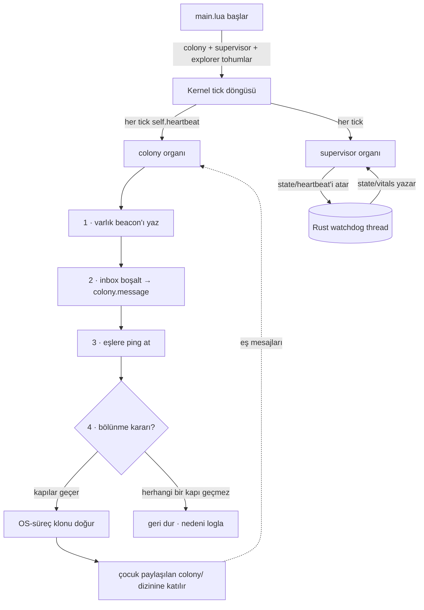

# EvoLua — kendini geliştiren bir Lua organizması

[🇬🇧 English](README.md) · 🇹🇷 Türkçe · **site:** [yasinyaman.github.io/evolua](https://yasinyaman.github.io/evolua/)

EvoLua, deneysel ve tamamen bağımsız bir "dijital organizma"dır. Çalıştığı ortamı
**algılar** (süreç-başına CPU/RAM, OS hata logları, dosya sistemi), varlık-bazlı bir
**dünya modeli** kurar, durumu **anlamlandırır** (opsiyonel gömülü LLM + BM25 RAG, kural
fallback), ve bir otonomi merdiveninde **hareket eder** — gerçek bir **genetik sistemle**
(tipli-kural genomları, dürüst fitness, çeşitlilik) kendi eklentilerini ("organlar") büyütür,
**haberleşen süreçlerden oluşan bir koloniye çoğalır**, yavrularına **amaç edindirir**,
**ortamını keşfeder** ve geri rapor verir. Tek bir binary.

> **Her şeyi şekillendiren çekirdek fikir:** Rust host hiç değişmez ve `lua/core/` değişmez
> bir sözleşmedir. Yeni yetenek *her zaman* yeni bir `.lua` dosyasıdır — asla çekirdek
> düzenlemesi değil. Organizma bu dosyaları runtime'da genom blueprint'lerinden kendisi yazar.

Tek kasıtlı istisna, organizmanın vital'lerini gözleyip geri besleyen ince, host-tarafı bir
**süpervizör** ("beyin sapı")dır — gözler, asla yönlendirmez (aşağıda).

> Gerçek bir koşunun açıklamalı çıktısı için: **[docs/DEMO.tr.md](docs/DEMO.tr.md)**.

---

## Hızlı başlangıç

```bash
cargo build --release                                   # varsayılan: çevrimiçi beyin + yerel GGUF çalışma zamanı + yerel sunucular + indirici — model baytı YOK (~6 MB)
cargo build --release --no-default-features             # yalnızca algı + kurallar (beyin yok)
scripts/fetch_model.sh                                  # embed_smol için models/smol.gguf (sha256 doğrulamalı)
cargo build --release --features embed_smol             # + küçük SmolLM2-135M'i gömülü taşı (tamamen çevrimdışı hostlar)
cargo build --release --features apple                  # + macOS'un cihaz-içi modelini beyin yap (macOS 26+)
cargo build --release --features gpu-metal              # yerel beyin için macOS GPU arka ucu

./target/release/evolua --ticks 60 --tick-seconds 0.2        # sınırlı hızlı demo
./target/release/evolua --goal "report errors"               # direktifli (Türkçe de kabul)
./target/release/evolua --clone --clone-ignore-battery       # koloni büyütsün
./target/release/evolua                                      # süresiz yaşar
```

Lua binary'ye statik gömülüdür; bunun dışında yalnızca sistem kütüphanelerine bağlanır (Linux'ta
glibc, macOS'ta /usr/lib). Tamamen statik bir Linux binary'si için:
`rustup target add x86_64-unknown-linux-musl && cargo build --release --target x86_64-unknown-linux-musl`
(`musl-tools` gerekir). Etiketli sürümler (`v*`) Linux x86_64 (statik, musl) ve macOS (arm64,
x86_64) için varsayılan özellikli hazır binary'ler ekler — bkz. `.github/workflows/release.yml`.

**Derlemeden çalıştır** — stok bir `lua` (5.3+) organizmayı doğrudan koşar:

```bash
lua lua/main.lua --ticks 60 --tick-seconds 0.2
```

> Saf-Lua modunda veri evi varsayılan olarak betiğin yanındadır (`lua/`); binary'deki gibi yönlendir: `EVOLUA_HOME=/yol lua lua/main.lua`.

---

## Neler yapabilir

| Faz | Yetenek |
|---|---|
| **1 · Keskin algı** | süreç-başına CPU/RAM (`proc_top`), OS çökme/hata logları (`proc_errors`), varlık-bazlı **dünya modeli**, kural-tabanlı durum raporları |
| **2 · Karar beyni** | bir model tüm-sistem snapshot'ını **anlamlandırır** — anahtar varsa bir **çevrimiçi servis** (önce ücretsiz katmanlar), yoksa **makinede zaten olan** bir model (Ollama / LM Studio / HF-önbellek GGUF'ları, çalışan yerel LLM servisi, macOS'un cihaz-içi modeli), yoksa hosta göre boyutlanmış bir indirme; yaşam boyunca çevrimiçi ↔ yerel **failover**; fitness-ağırlıklı **BM25 RAG** ile öğrenir; beyin yoksa kurala düşer |
| **3 · Otonomi + merak** | **L0–L4 merdiveni**, dosya tabanlı **onay inbox**, güvenli-liste + geri-alınabilirlik + denetim günlüğü, `curiosity` aktif keşif |
| **4 · Meta-evrim** | host'u ölçer (`hostcaps`), beyin darboğaz + kapasite varsa **model merdiveninde** tırmanır; indirme + checksum; başarısız indirme her kontrolde tekrarlanmaz, geri çekilir; yeni beyin kurallara daha sık düşerse **rollback** önceki modeli geri getirir |
| **5 · Koloni, süpervizör, amaç, keşif** | **kendini çoğaltma** — `--mesh` ile **makineler arası** da (LAN keşfi, Tailscale/WAN için seed; posta, gen havuzu ve amaç defteri köprülenir; bir düğüm eşinin **modelini** ya da **internetini** ödünç alabilir); akıllı **ne zaman bölünmeli** kararı; host-tarafı **süpervizör**; **amaç edinme** (koloni hangi amacın ödül getirdiğini öğrenir); ve **ortam keşfi** (kendi duyularını büyütür) |
| **6 · Sentez — beyin organ yazar** | şablonlar yalnızca *taban*: `synth` organı bir hedefi ya da sahipsiz bir uyaranı tek cümlelik teknik brife çevirir, **gerçek komutları çalıştırır** ve çıktısını (dolgulu tabloların sütun haritasıyla) modele gösterir, modele yepyeni bir organ yazdırır, ayrıştırıcıyı o gerçek satırlara karşı **kuru-koşar ve pre-flight eder** — sütun sütun — kurar ve dürüst fitness + rapor değeri seçsin diye bırakır; başarısızlıklar bir sonraki denemeye beslenir ("bu yaklaşımı tekrarlama") |

Faz 1–4 özgün organizma; **Faz 5** derinlemesine [docs/COLONY.md](docs/COLONY.md)'de.

---

## Faz 5 — bakışta

### Program akışı



### Kendini çoğaltma (opt-in: `--clone`)
Paylaşılan `$EVOLUA_HOME/colony/` dizini üzerinden her örnek bir varlık beacon'ı yazar, posta
kutusunu boşaltır ve canlı eşlere ping atar. `--clone` ile gerçek OS-süreç klonları doğurur;
**fork-bomb'a karşı üç katmanlı sınırla** (nesil derinliği, koloni boyutu, koloni-geneli
cooldown kilidi). Çocuklar **ölümlü** ve `--no-clone` ile açılır — yalnız kök bölünür.
Güvenlik sınırları **gen değil**, `config.lua`'da; hiçbir gen değişikliği onları gevşetemez.
Koloni organının kendisi korumalı bir tekil organdır: evrimcinin tek spawn kapısı hiçbir sürüşten
ikinci bir kopyaya izin vermez, `--no-colony` ise onu yaşam boyunca kapatır.

### Ne zaman bölünmeli bir karardır
Sırf yer var diye bölünmez. Yalnız gerçek **yük** altında (karşılanmayan ihtiyaç / beyin
darboğazı / host ısısı) **ve** host'un **kapasitesi** varken (boş RAM, pilde değil) bölünür —
model merdiveninin "darboğaz + boş kapasite" kuralını aynalar. `--clone-eager` kapıyı atlar;
`--clone-ignore-battery` yalnız güç korumasını düşürür.

### Amaç edinme — yavrular bir amaçla doğar
Klon generic kopya değildir. Bölünme anında koloni, ebeveynin yaşadığından bir **amaç
kristalize eder** ve `--goal` olarak geçer; çocuk **directed** açılıp tam o nişin organlarını
büyütür. **explore** (en kronik karşılanmayan uyaran → boşluğu doldur) · **exploit** (en
yüksek-fitness niş → kazananı derinleştir) · **portfolio** (dönüşümlü). Her bölünme
`colony/lineage.log`'a yazılır.

Üstelik **hangi amacın ödül getirdiğini öğrenir** (S4): her çocuk amacının ödülünü
`colony/outcomes/`'a hasat eder; kök kristalleşmeyi bir **amaçlar üzerinde bandit** ile yapar
(denenmemişlere iyimser önsel, boşluk için epsilon). Böylece koloni değerli amaçları evrimsel
olarak korur.

### Ortam keşfi — organizma kendi duyularını büyütür
Tohumlanan `explorer` organı host'u dolaşır — dosya sistemi dizinleri, log dosyaları, dinleyen
ağ portları, **`$PATH`'teki kurulu komutlar/araçlar** (`git`, `docker`, derleyiciler…), sistem
bilgisi. Asıl etkisi **algı genişlemesi**: bulduğu dizin/log'u `watch_dirs`/`watch_logs`'a
ekler → fswatch/logwatch onları algılamaya başlar → yeni uyaranlar → organ büyümesi → ve koloni
üzerinden **yeni amaçlar**. Dışa-dönük keşfeder (`target/`/`.git` atlanır).

### Host-tarafı süpervizör ("beyin sapı")
Rust host'un doğurduğu arka-plan thread'i (`src/supervisor.rs`). **Gözetim, kontrol değil**:
canlılığı (`state/heartbeat`) gözler, kaba vital'leri (`stall`, `self_rss_mb`, `colony_procs`)
`state/vitals`'a yazar; Lua organı bunları `host.vitals` uyaranı olarak yüzeye çıkarır →
**evrilebilir** katman karar verir. Tek sert refleks (uzun takılmada çıkış) **opt-in ve
varsayılan kapalı** (`EVOLUA_WATCHDOG_KILL=1`).

---

## Evrim motoru — organlar gerçekte nasıl evrilir

Fazların altında, evolver artık sabit şablonlar üzerinde sayısal-parametre ayarlayıcısı
değil — gerçek bir genetik sistem. (Tasarım + doğrulama: [docs/ROADMAP.md](docs/ROADMAP.md#evolution-engine-enrichment).)

| Mekanizma | Ne yapar |
|---|---|
| **Dürüst fitness** | ödül, organın *beyan ettiği* sayıdan değil *gözlemlenebilir bus olgularından* türetilir — aç bir uyaranı doldurma (sürpriz) ÷ ortak-işleyenler (fazlalık paylaşımı) − ölçülen maliyet. Reward-hacking'i kırar (örn. koloninin her heartbeat'te kendine ödül basması). |
| **Turnuva + yumuşak ölüm** | k-turnuva üreme (yalnız en fit değil) + olasılıksal eleme çeşitliliği korur; tohumlanan altyapı soyları (colony/supervisor/explorer/synth) tekil: elemeden muaf ve hiçbir sürücü ikinci kopyasını büyütemez. |
| **Rule-DSL / genetik programlama** | bir `rule` organının genomu tipli kural listesidir — `when <stimulus> if <field> <op> <value> then <report\|log\|emit\|act>`. Mutasyon yapıyı yeniden yazar, crossover iki ebeveyni birleştirir. Gramer **yalnız güvenli primitifler** üretir (`os`/`io` yok) → yapısal **capability-isolation**. |
| **Quality-Diversity (MAP-Elites)** | davranış arşivi her niş için en iyi organı tutar (birincil uyaran × abonelik genişliği); hücre elitleri korunur, üreme boş nişleri *aydınlatır* — tek tepe yerine **yetkinler repertuarı**. |
| **Öz-uyarlanan (ES) mutasyon** | her sayısal gen kendi log-normal mute edilen adım boyunu (`sigma`) taşır, nesiller boyu kalıtılır. |
| **Güvenlik-gated aktüatör + outcome-credit** | bir `rule` organı `act` edebilir — ama yalnız *istek yayar*; core autonomy merdiveni karar verir, evrilen organlar için **varsayılan onay-kapılı** (bu kopyada asla otonom). Aksiyon sonrası organ, ancak hedefin ölçülen yükü gerçekten düşerse ödüllenir — taklit edilemez eligibility-trace. |
| **Gen transferi** | **dikey** — klon, hedef şablonu için ebeveynin en iyi ayarlı genlerini miras alır; **yatay** — koloni eşleri paylaşılan gen havuzu üzerinden yüksek-fitness genom takas eder. |
| **Bandit şablon seçimi** | UCB banditi ödeme yapan şablonlara üreme yatırır, her birini bir kez dener (optimist önsel) — reaktif ihtiyaç-sürücüsünün ötesinde proaktif keşif. |

İki dosya dinamiği görünür kılar: **`state/evolution.log`** (jenerasyon başı TSV — popülasyon,
mean/max/min/stddev fitness, tür sayısı, MAP-Elites kapsamı, fallback oranı) ve
**`state/repertoire.txt`** (güncel QD haritası — hücre başına en iyi organ).

Bunlar `lua/core/`'a yapılan ender ama haklı düzenlemelerdir (ödül fonksiyonu, seçilim döngüsü,
varyasyon operatörleri ve QD arşivi seçilimin *alt-katmanıdır* — döngüsellik olmadan evrilebilir
bir organ olamazlar). Kural grameri ise `templates.lua`'da (blueprint katmanı) yaşar.

---

## Mimari

`src/main.rs` ince bir kabuktur: `lua/`'yu `rust-embed` ile gömer, her modülü
`package.preload`'a kaydeder, veri evini çözer, süpervizör thread'ini doğurur ve global'leri
(`EVOLUA_HOME`, `arg`, dosya-sistemi ve model-keşif yardımcıları, beyin yükleyicisi `host_brain_*`,
feature açıksa `model_acquire`) enjekte eder. Hangi beynin yükleneceğine Lua karar verir
(`core/brain.lua`); beyin yoksa reasoner kurallarla çalışır.

### Dosyalar

| Dosya | Rol |
|---|---|
| `src/main.rs` | tek-binary host: `lua/` kaynağını gömer, veri evini çözer, global'leri enjekte eder, süpervizörü + mesh'i doğurur |
| `src/supervisor.rs` | host-tarafı otonom gözcü ("beyin sapı"): canlılık + vitals, asla zorlamaz |
| `src/mesh.rs` | host-tarafı **mesh** siniri (opt-in): UDP/seed keşfi + TCP posta + defter dedikodusu (gen havuzu, amaç sonuçları); `colony/` dizinini makineler arası köprüler; beacon'lar yetenek taşır (beyin, sunulan model, internet, gateway) — bir düğüm eşinin **modelini** ya da **internetini** ödünç alır |
| `src/netproxy.rs` | model yöneticisinin bir eşin gateway'ine yönlendirdiği süreç-geneli dış proxy (`net_proxy_set`) |
| `src/remote.rs` | **çevrimiçi** beyin: OpenAI-uyumlu uçlar + Anthropic, yaşam-başına çağrı bütçesi, hata izleme + geri çekilme (failover'ın host tarafı) — `remote` feature |
| `src/host.rs` | yerel dosya-sistemi yardımcıları (listele / dolaş / mkdir / cwd); algı yolları shell komutuna girmez |
| `src/discover.rs` | makinede zaten olan beyinleri bulur: Ollama / LM Studio / Jan / GPT4All / HF / llama.cpp GGUF'ları, başlıklarından okunur |
| `src/brain.rs` | karar beynini istek üzerine yükler ve değiştirir (`host_brain_*`) |
| `src/service.rs` | çalışan yerel bir LLM sunucusunu beyin olarak kullanır — `service` feature |
| `src/apple.rs` · `src/apple/bridge.swift` | macOS'un cihaz-içi modelini beyin olarak kullanır (Swift köprüsünü `build.rs` derler) — `apple` feature |
| `src/llm.rs` | süreç-içi GGUF beyni (llama-cpp-2 CPU, modelin kendi sohbet şablonu) — `llm`/`embed_smol` feature |
| `src/acquire.rs` | GGUF indirme + SHA-256 + atomik takas; eski dosyayı rollback için `.prev` olarak saklar — `acquire` feature |
| `lua/core/kernel.lua` | yaşam döngüsü / tick loop; ödül-ceza → fitness |
| `lua/core/bus.lua` | event bus (pub/sub) — sinir sistemi; olay-başına istatistik |
| `lua/core/memory.lua` | yaşamlar-arası kalıcı bellek; fitness, nesil, sayaçlar |
| `lua/core/serialize.lua` | tek serileştirici: bellek, organ genleri, kalıtılan genomlar |
| `lua/core/registry.lua` | plugin yükleyici + sandbox + hot-reload + emeklilik |
| `lua/core/templates.lua` | **genom blueprint'leri** — organ kaynağını üretir; **rule-DSL/GP** organı + `colony`, `supervisor`, `explorer` ve `synth` (model-yazımı organ döngüsü) |
| `lua/core/evolver.lua` | evrim motoru: ihtiyaç/hedef/**bandit** üretim, **turnuva** seçilimi + yumuşak ölüm, **MAP-Elites** arşivi, **ES** mutasyon, **crossover**, dürüst-fitness sıralaması |
| `lua/core/evo_util.lua` | paylaşılan evrim operatörleri (Box–Muller gauss + öz-uyarlanan ES adımı) |
| `lua/core/worldmodel.lua` | varlık (süreç-başına) dosyaları: CPU/hata/sıcaklık/eğilim/salience |
| `lua/core/reasoner.lua` | anlamlandırma: snapshot → karar şeması (LLM+RAG, kural yedeği) |
| `lua/core/brain.lua` | hangi beyinle düşünüleceği: açılışta seçim (çevrimiçi → makine → anahtarsız → varsayılan), sağlayıcılar + anahtarlar, bu makinedeki adaylar, geçiş |
| `lua/core/rag.lua` | fitness-ağırlıklı BM25 deneyim bankası |
| `lua/core/autonomy.lua` | L0–L4 merdiveni + onay kutusu + güvenli-liste + denetim logu; **evrilen organ aksiyon istekleri + sonuç-kredisi** |
| `lua/core/hostcaps.lua` | host ölçümü (RAM/çekirdek/güç/disk) |
| `lua/core/modelmgr.lua` | meta-evrim: model merdiveni + kapasite/ihtiyaç kararı + geri alma; çevrimiçi↔yerel **failover**, anahtar alımı, mesh yetenekleri + ödünç alma |
| `lua/core/platform.lua` | OS soyutlaması (mac/linux/win): süreç listesi, hata logları, aktüatörler, shell tırnaklama, dosya-sistemi dolaşma |
| `lua/core/reporter.lua` | aktüatör: durum özeti + gözlemler → Markdown raporlar; **rapor değeri** (sessizlikten sonra bir bulgu kazandırır, aynı biçimli tekrar kaybettirir) |
| `lua/sensors/*.lua` | `sys_metrics`, `logwatch`, `fswatch`, `introspect`, `proc_top`, `proc_errors`, `curiosity` |
| `lua/config.lua` | tüm "içgüdüler" düz sayılar olarak (eşikler, kadanslar, sınırlar, koloni/amaç) |
| `lua/main.lua` | giriş noktası + CLI bayrak ayrıştırıcı + organ tohumlama |

---

## İki mod

| Mod | Nasıl | Davranış |
|---|---|---|
| **free** | hedefsiz | ortamı gözler; karşılayamadığı her tekrarlayan uyarana organ büyütür |
| **directed** | `--goal "..."` | hedef anahtar kelimelerine göre ilgili organları öncelikli büyütür (TR/EN; *izle*/*monitor*/*rapor* gibi genel kelimeler tek başına büyütmez), sonra serbest evrim sürer |

---

## Karar beyni — neyle düşünür

Binary **model taşımaz**. Reasoner'ın bir modele tek ihtiyacı kısa bir karar şemasını doldurmak
(synth organının ise kod yazacak daha güçlü bir modele), bu yüzden EvoLua beyni şu sırayla arar
ve yaşamı boyunca aralarında **failover** yapar:

| Tür | Nereden gelir | Build feature |
|---|---|---|
| `remote` | anahtarı ortamda **ya da veri evindeki tek satırlık `keys/<sağlayıcı>` dosyasında** bulunan bir **çevrimiçi servis** — önce ücretsiz katmanlar: `groq` → `cerebras` → `gemini` → `openrouter` (ücretsiz model) → `mistral` → `github` → `huggingface`, sonra ücretli `openai` / `anthropic`; **anahtarsız** açık uç (`pollinations`) yalnızca makinede kullanmaya değer bir şey yoksa. OpenAI-uyumlu herhangi bir URL de olur (`--llm-api https://host/v1`, `anthropic+URL` Anthropic protokolünü sabitler) | `remote` |
| `gguf` | başka bir aracın indirdiği GGUF — Ollama'nın modelleri (düz GGUF blob'ları), LM Studio, Jan, GPT4All, Hugging Face ve llama.cpp önbellekleri, `$EVOLUA_MODEL_DIRS` / `model_dirs` / `--model-dir` | `llm` |
| `service` | localhost'ta çalışan Ollama, LM Studio, llama-server ya da başka bir OpenAI-uyumlu sunucu (veya `$EVOLUA_SERVICE_URLS`) — EvoLua asla başlatmaz | `service` |
| `apple` | macOS'un cihaz-içi Foundation modeli (macOS 26+, Apple Intelligence açık; OS yönetir, bizim sürecimizde RAM tutmaz) | `apple` |
| indirme | hosta göre boyutlanmış pinli merdiven — Qwen2.5-Coder-Instruct 0.5B → 1.5B → 3B → 7B (url + sha256) — otonomi merdiveninden geçer, inince sıcak takılır, bir daha indirilmez | `acquire` |
| `embedded` | binary'ye gömülü SmolLM2-135M (`scripts/fetch_model.sh`) — yalnızca tamamen çevrimdışı hostlar için | `embed_smol` |

**Organizmanın kendi varsayılan beyni değişmez**: indirdiği bir `models/decision.gguf`, yoksa
binary'ye gömülü model (varsa). Geri kalan her şey daha iyiyse onun *yerine* kullanılır;
varsayılan yedek olarak kalır. Açılışta (`--brain auto`, varsayılan) `core/brain.lua` şunu seçer:

1. `$EVOLUA_MODEL` / `--model <gguf>` verilmişse o (her zaman kazanır);
2. yoksa **anahtarı olan bir çevrimiçi servis** (`--llm-api auto`, önce ücretsiz katmanlar);
3. yoksa makinedeki, türü ne olursa olsun, varsayılandan büyük, sığan (fiziksel RAM'in
   `model_ram_share` payı, varsayılan %25; isteğe bağlı `model_max_mb` tavanı), geri çekilmemiş
   ve yüklenebilen **en büyük** beyin;
4. yoksa varsayılan (indirilmiş `decision.gguf`, ya da `embed_smol` build'inde gömülü model); varsayılan
   yoksa ya da yüklenemezse anahtarsız açık uç; o da yoksa kurallar.

**Failover:** art arda üç çevrimiçi hata (ağ engeli, kota, kesinti; `401/402/403` ve `429` hemen) servisi
geri çekilme penceresine alır; bu sürede çağrılar doğrudan yerel beyne düşer. Model yöneticisi
yüklü yerel beyin yoksa birini yükler (makinedeki beyin, yoksa varsayılan), servisi model-kontrol
kadansında yoklar ve yanıt verince geri döner — yerel modelin RAM'ini bırakır. Hiçbir yerde
anahtar yoksa `approvals/api-key-wanted.md` yazar (ücretsiz sağlayıcılar, anahtar nereden alınır,
nereye bırakılır) ve yerel beyinle / kurallarla sürer; `keys/<sağlayıcı>` dosyasına bırakılan
anahtar yeniden başlatmadan devreye girer. Hiçbir sağlayıcı bir programın kendi kendine kayıt
olmasına izin vermez; o adım insanda kalır.

"Kullanabilir" sonra pratikte sınanır. Makinede bulunan beyin deneme süresinde başlar; kurallara
`model_fallback_rate`'ten sık düşerse varsayılana dönülür. Karar başına `brain_max_seconds`'tan
(varsayılan 10 sn; ısınma yanıtı sayılmaz) yavaşsa bir küçüğüne inilir. İki durumda da o beyin
geri çekilir, sonraki yaşam doğru beyinden başlar. `--brain <tür>` (ya da `EVOLUA_BRAIN`) seçimi
daraltır, `--brain rules` modelleri kapatır. Bulunan modeller, onları yükleyemeyen bir build'de
bile raporlarda `discovered model: …` olarak görünür; her rapor etkin beyni yazar.

Yaşam içinde beyin kurallara fazla sık düşerse model yöneticisi önce **`model_adopt`** önerir —
makinedeki bir sonraki büyük beyne indirmesiz geçiş — ancak sonra indirme merdivenine başvurur
(kullanılan beyinden küçük bir seviyeyi asla indirmez). Her geçiş anında etkin olur, taze
örneklerle değerlendirilir ve yeni beyin daha kötü çıkarsa geri alınır; sonraki bir yaşamda
yüklenemeyen bir beyin bırakılır.

## Veri evi düzeni (`$EVOLUA_HOME`)

```
plugins/    organizmanın yazdığı organlar (gen_*.lua; model-yazımı syn_*.lua)
reports/    zaman damgalı Markdown raporlar
state/      memory.lua · evolua.log · audit.log · heartbeat · vitals · supervisor.log
            evolution.log (jenerasyon metrikleri) · repertoire.txt (MAP-Elites QD haritası)
            mesh_id · mesh_caps · mesh.log (--mesh)
approvals/  pending-*.md → (sen) approved/ → done/ · api-key-wanted.md (çevrimiçi anahtar yok)
keys/       <sağlayıcı> — tek satırlık API anahtarı dosyaları, canlı alınır
models/     indirilen modeller + current_tier
colony/     peers/<id> (mesh eşleri için addr=) · inbox/<id>/ · clone.lock
            genepool/<şablon> (yatay gen transferi) · outcomes/<id> (S4 ödül hasadı) — ikisi de mesh'te dedikodulanır
            children/<id>/ (klon alt-evleri; inherited.lua = dikey gen transferi)
            lineage.log (amaç defteri)
```

| OS | Varsayılan veri evi |
|---|---|
| macOS | `~/Library/Application Support/EvoLua/` |
| Linux | `$XDG_DATA_HOME/evolua` veya `~/.local/share/evolua/` |
| Windows | `%APPDATA%\EvoLua\` |

---

## CLI bayrakları (seçme)

```
--mode <free|directed>     yaşam modu (varsayılan: free)
--goal "<text>"            direktifli mod (--mode directed ima eder)
--ticks <n>                n tick koş, sonra dinlen (varsayılan: sonsuz)
--tick-seconds <s>         tick başına saniye (hızlı demo için 0.2)
--brain <tür>              karar beyni: auto|rules|remote|gguf|embedded|service|apple (varsayılan: auto)
--autonomy <lvl>           otonomi tavanı: learn|report|notify|suggest|act (varsayılan: report)
--unattended               kendi başına davran + onaysız daha iyi model indir
                           (= EVOLUA_UNATTENDED=1; varsayılan kapalı)
--llm-api <auto|sağlayıcı|url>  çevrimiçi beyin (varsayılan auto = önce ücretsiz katmanlar)
--llm-model <ad>           o servisteki model · --llm-key-env <VAR> · --llm-budget <n>
--no-llm-api / --no-llm-keyless   hiç çevrimiçi olma / anahtarsız açık ucu kullanma
--model <yol.gguf>         bu yerel modeli kullan · --model-dir <yol> ek GGUF dizini (tekrarlanabilir)
--model-max-mb <n>         model boyutu tavanı · --no-model-discover · --model-force-upgrade
--no-synth                 sentezleyiciyi büyütme (model-yazımı organlar)
--mesh                     başka hostlardaki organizmalara katıl (LAN yayını + TCP posta + defter dedikodusu)
--mesh-seed <host:port>    Tailscale/VPN/WAN üzerinden bir eşe duyur (tekrarlanabilir; --mesh ima eder)
--mesh-port <n>            mesh UDP/TCP portu (varsayılan: 7707) · --mesh-gateway  eşlere internet gateway'i ol
--clone                    OS-süreç klonlamasına izin ver (varsayılan: kapalı)
--clone-eager              yer varsa hep böl (yük/kapasite kapısını atla)
--clone-ignore-battery     pilde de klon doğur
--clone-generalist         klonlar generic kopya (amaç kristalleşmesini atla)
--purpose-mode <m>         amaç seçimi: explore|exploit|portfolio
--no-purpose-learn         S4'ü kapat (amaçları ödüle göre yanlamayı bırak)
--clone-max-peers <n>      eşzamanlı canlı örnek tavanı (varsayılan: 3)
--clone-generations <n>    klon derinliği tavanı, kök=0 (varsayılan: 1)
--no-colony / --no-supervisor / --no-explorer / --no-rule   ilgili organı hiç büyütme
--no-explore-expand        keşfet ama algıyı otomatik genişletme (watch dizin/log ekleme)
--explore-root <path>      explorer'ın dolaşacağı bir dizin ekle (tekrarlanabilir)
```

Beyin env: `EVOLUA_LLM_API`, `EVOLUA_LLM_MODEL`, `EVOLUA_LLM_BASE` (proxy/test taban URL'si),
`EVOLUA_LLM_CTX` (yerel bağlam, varsayılan 4096), `EVOLUA_MODEL` (açık GGUF), `EVOLUA_BRAIN`.
Süpervizör env: `EVOLUA_WATCHDOG` (0=kapalı), `_SECS`, `_STALL`, `_KILL` (opt-in son-çare çıkış), `_KILL_SECS`.
Mesh env: `EVOLUA_MESH`, `EVOLUA_MESH_PORT`, `EVOLUA_MESH_SEEDS`, `EVOLUA_MESH_TOKEN`.

---

## Otonomi merdiveni

| Seviye | Eylem | Koşul |
|---|---|---|
| **L0 öğren** | dünya modelini güncelle | her zaman |
| **L1 raporla** | durum raporuna yaz | varsayılan tavan |
| **L2 bildir** | OS bildirimi | yüksek salience |
| **L3 öner** | `approvals/pending-*` yaz, bekle | güven orta+ |
| **L4 müdahale** | otonom aksiyon (yalnız geri-alınabilir + güvenli-liste) | güven ≥ eşik **ve** tavan ≥ L4 |

`autonomy_ceiling` merdiveni keser. Yıkıcı aksiyonlar (kill) **her zaman** onay ister.
**Evrilen organlar** (rule-DSL `act`) daha da muhafazakâr sınırlanır — `evolved_action_ceiling`
varsayılanı `suggest`, yani istekleri global tavandan bağımsız olarak onay kutusuna gider, asla
otonom değil. Onay bir dosya dansıdır: `approvals/pending-<id>.md` dosyasını `approved/` içine taşı
(uygulanır, `done/` altına arşivlenir), reddetmek için sil. Her karar/aksiyon `state/audit.log`'a yazılır.

Varsayılan tavan **`report`**: organizma yalnızca rapor yazar. `--autonomy suggest` önerilen
aksiyonları (ve model yükseltmelerini) onay kutusuna gönderir. Gözetimsiz çalışma **opt-in**'dir:
`--unattended` (ya da `EVOLUA_UNATTENDED=1`) `autonomy_ceiling = "act"`, `model_unattended = true`
yapar ve `model_upgrade`'i güvenli listeye ekler; organizma geri-alınabilir aksiyonları alır ve
sormadan daha iyi bir karar modeli indirir.

---

## Test & sıfırlama

Saf parçalar için birim testler: `lua tests/run.lua` (derleme gerekmez) ve `cargo test`.
Davranış sınırlı koşularla doğrulanır: `scripts/fulltest.sh` (CI Ubuntu ve macOS'ta koşar);
her kontrolün neyi kanıtladığı ve son sonuç [docs/TESTING.md](docs/TESTING.md)'de. Gerçek bir
koşunun açıklamalı çıktısı: [docs/DEMO.tr.md](docs/DEMO.tr.md).

```bash
lua tests/run.lua      # birim testler (stok Lua)
cargo test             # host birim testleri
scripts/fulltest.sh    # sınırlı davranış suite'i
./clean.sh   # evrimleşmiş organları/raporları/belleği sil; sonraki koşu sıfırdan
```

---

## Güvenlik

Organlar kasıtlı geniş yetkili bir Lua sandbox'ında koşar (`os`/`io` açık). Otonomi varsayılanı
`report`; gözetimsiz çalışma için `--unattended` gerekir. Kendini çoğaltma
**varsayılan kapalı** ve açıkken üç katmanlı sınırlı; süpervizör opt-in son-çare dışında
**yalnız gözler**. Tanımadığın bir host'ta çalıştırmadan önce `watch_dirs`/`watch_logs`/
`autonomy_ceiling`'i gözden geçir.

---

## Sorumluluk reddi

EvoLua **deneysel araştırma / eğitim amaçlı yazılımdır**; [MIT Lisansı](LICENSE) altında
**"olduğu gibi"**, **hiçbir garanti vermeden** sunulur. **Kendi sorumluluğunda** kullan.

Tasarımı gereği:
- **geniş yetkilerle çalışır** — organlar kasıtlı geniş yetkili bir Lua sandbox'ında koşar (`os`/`io` açık);
- **host'unu gözler** — süreç-başına istatistik, OS hata logları ve (explorer ile) dizinleri, log dosyalarını, dinleyen portları ve `$PATH`'ini tarar (salt-okunur);
- **kendini çoğaltabilir** — `--clone` ile gerçek OS süreçleri doğurur (sınırlı, ama gerçek);
- **istersen kendi başına davranır** — `--unattended` (ya da `EVOLUA_UNATTENDED=1`) geri-alınabilir aksiyonları (hatta sormadan model indirmeyi) açar. Varsayılan (`autonomy_ceiling = "report"`) yalnızca raporlar.

Önemli ya da tanımadığın bir sistemde çalıştırmadan önce `watch_dirs`/`watch_logs`/
`autonomy_ceiling`'i gözden geçir, ürettiği organları (`plugins/`) incele ve yalnızca yetkili
olduğun yerde çalıştır. Yazarlar ve katkıda bulunanlar; oluşabilecek hasar, veri kaybı, kaynak
tüketimi veya diğer sonuçlardan **sorumlu değildir**.

---

## Dokümantasyon

- [docs/DEMO.tr.md](docs/DEMO.tr.md) — gerçek bir koşunun açıklamalı çıktısı (inceleyenler için)
- [docs/COLONY.md](docs/COLONY.md) — Faz 5 derinlemesine
- [docs/TESTING.md](docs/TESTING.md) — doğrulama suite'i
- [docs/ROADMAP.md](docs/ROADMAP.md) · [docs/BUILD-PLAN.md](docs/BUILD-PLAN.md) — tasarım gerekçeleri · build planı
- [CLAUDE.md](CLAUDE.md) — AI asistanları için rehber
