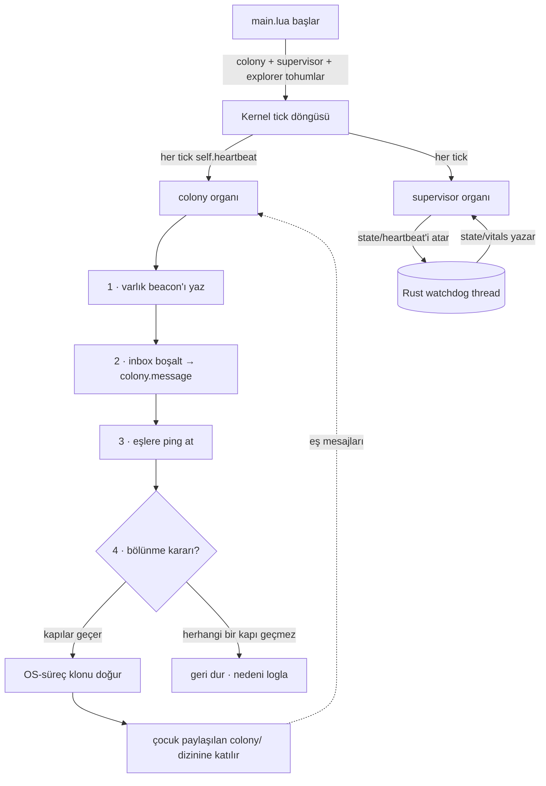

# EvoLua — kendini geliştiren bir Lua organizması

[🇬🇧 English](README.md) · 🇹🇷 Türkçe

EvoLua, deneysel ve tamamen bağımsız bir "dijital organizma"dır. Çalıştığı ortamı
**algılar** (süreç-başına CPU/RAM, OS hata logları, dosya sistemi), varlık-bazlı bir
**dünya modeli** kurar, durumu **anlamlandırır** (opsiyonel gömülü LLM + BM25 RAG, kural
fallback), ve bir otonomi merdiveninde **hareket eder** — gerçek bir **genetik sistemle**
(tipli-kural genomları, dürüst fitness, çeşitlilik) kendi eklentilerini ("organlar") büyütür,
**haberleşen süreçlerden oluşan bir koloniye çoğalır**, yavrularına **amaç edindirir**,
**ortamını keşfeder** ve geri rapor verir. Tek bir binary.

> **Her şeyi şekillendiren çekirdek fikir:** Rust host hiç değişmez ve `lua/core/` değişmez
> bir sözleşmedir. Yeni yetenek *her zaman* yeni bir `.lua` dosyasıdır — asla çekirdek
> düzenlemesi değil. Organizma bu dosyaları runtime'da genom blueprint'lerinden kendisi yazar.

Tek kasıtlı istisna, organizmanın vital'lerini gözleyip geri besleyen ince, host-tarafı bir
**süpervizör** ("beyin sapı")dır — gözler, asla yönlendirmez (aşağıda).

> Gerçek bir koşunun açıklamalı çıktısı için: **[docs/DEMO.tr.md](docs/DEMO.tr.md)**.

---

## Hızlı başlangıç

```bash
cargo build --release                                   # algı + kurallar (LLM yok)
cargo build --release --features embed_smol             # + gömülü karar beyni
cargo build --release --features 'embed_smol acquire'   # + runtime model yükseltme

./target/release/evolua --ticks 60 --tick-seconds 0.2        # sınırlı hızlı demo
./target/release/evolua --goal "report errors"               # direktifli (Türkçe de kabul)
./target/release/evolua --clone --clone-ignore-battery       # koloni büyütsün
./target/release/evolua                                      # süresiz yaşar
```

**Derlemeden çalıştır** — stok bir `lua` (5.3+) organizmayı doğrudan koşar:

```bash
lua lua/main.lua --ticks 60 --tick-seconds 0.2
```

> Saf-Lua modunda veri evini bir global enjekte ederek yönlendir: `lua -e "EVOLUA_HOME='/yol'" lua/main.lua`.

---

## Neler yapabilir

| Faz | Yetenek |
|---|---|
| **1 · Keskin algı** | süreç-başına CPU/RAM (`proc_top`), OS çökme/hata logları (`proc_errors`), varlık-bazlı **dünya modeli**, kural-tabanlı durum raporları |
| **2 · Karar beyni** | gömülü minik model (SmolLM2-135M) tüm-sistem snapshot'ını **anlamlandırır**; fitness-ağırlıklı **BM25 RAG** ile öğrenir; model yoksa kurala düşer |
| **3 · Otonomi + merak** | **L0–L4 merdiveni**, dosya tabanlı **onay inbox**, güvenli-liste + geri-alınabilirlik + denetim günlüğü, `curiosity` aktif keşif |
| **4 · Meta-evrim** | host'u ölçer (`hostcaps`), beyin darboğaz + kapasite varsa **model merdiveninde** tırmanır; indirme + checksum + rollback |
| **5 · Koloni, süpervizör, amaç, keşif** | **kendini çoğaltma**; akıllı **ne zaman bölünmeli** kararı; host-tarafı **süpervizör**; **amaç edinme** (koloni hangi amacın ödül getirdiğini öğrenir); ve **ortam keşfi** (kendi duyularını büyütür) |

Faz 1–4 özgün organizma; **Faz 5** derinlemesine [docs/COLONY.md](docs/COLONY.md)'de.

---

## Faz 5 — bakışta

### Program akışı



### Kendini çoğaltma (opt-in: `--clone`)
Paylaşılan `$EVOLUA_HOME/colony/` dizini üzerinden her örnek bir varlık beacon'ı yazar, posta
kutusunu boşaltır ve canlı eşlere ping atar. `--clone` ile gerçek OS-süreç klonları doğurur;
**fork-bomb'a karşı üç katmanlı sınırla** (nesil derinliği, koloni boyutu, koloni-geneli
cooldown kilidi). Çocuklar **ölümlü** ve `--no-clone` ile açılır — yalnız kök bölünür.
Güvenlik sınırları **gen değil**, `config.lua`'da.

### Ne zaman bölünmeli bir karardır
Sırf yer var diye bölünmez. Yalnız gerçek **yük** altında (karşılanmayan ihtiyaç / beyin
darboğazı / host ısısı) **ve** host'un **kapasitesi** varken (boş RAM, pilde değil) bölünür —
model merdiveninin "darboğaz + boş kapasite" kuralını aynalar. `--clone-eager` kapıyı atlar;
`--clone-ignore-battery` yalnız güç korumasını düşürür.

### Amaç edinme — yavrular bir amaçla doğar
Klon generic kopya değildir. Bölünme anında koloni, ebeveynin yaşadığından bir **amaç
kristalize eder** ve `--goal` olarak geçer; çocuk **directed** açılıp tam o nişin organlarını
büyütür. **explore** (en kronik karşılanmayan uyaran → boşluğu doldur) · **exploit** (en
yüksek-fitness niş → kazananı derinleştir) · **portfolio** (dönüşümlü). Her bölünme
`colony/lineage.log`'a yazılır.

Üstelik **hangi amacın ödül getirdiğini öğrenir** (S4): her çocuk amacının ödülünü
`colony/outcomes/`'a hasat eder; kök kristalleşmeyi bir **amaçlar üzerinde bandit** ile yapar
(denenmemişlere iyimser önsel, boşluk için epsilon). Böylece koloni değerli amaçları evrimsel
olarak korur.

### Ortam keşfi — organizma kendi duyularını büyütür
Tohumlanan `explorer` organı host'u dolaşır — dosya sistemi dizinleri, log dosyaları, dinleyen
ağ portları, **`$PATH`'teki kurulu komutlar/araçlar** (`git`, `docker`, derleyiciler…), sistem
bilgisi. Asıl etkisi **algı genişlemesi**: bulduğu dizin/log'u `watch_dirs`/`watch_logs`'a
ekler → fswatch/logwatch onları algılamaya başlar → yeni uyaranlar → organ büyümesi → ve koloni
üzerinden **yeni amaçlar**. Dışa-dönük keşfeder (`target/`/`.git` atlanır).

### Host-tarafı süpervizör ("beyin sapı")
Rust host'un doğurduğu arka-plan thread'i (`src/supervisor.rs`). **Gözetim, kontrol değil**:
canlılığı (`state/heartbeat`) gözler, kaba vital'leri (`stall`, `self_rss_mb`, `colony_procs`)
`state/vitals`'a yazar; Lua organı bunları `host.vitals` uyaranı olarak yüzeye çıkarır →
**evrilebilir** katman karar verir. Tek sert refleks (uzun takılmada çıkış) **opt-in ve
varsayılan kapalı** (`EVOLUA_WATCHDOG_KILL=1`).

---

## Evrim motoru — organlar gerçekte nasıl evrilir

Fazların altında, evolver artık sabit şablonlar üzerinde sayısal-parametre ayarlayıcısı
değil — gerçek bir genetik sistem. (Tasarım + doğrulama: [docs/ROADMAP.md](docs/ROADMAP.md#evolution-engine-enrichment).)

| Mekanizma | Ne yapar |
|---|---|
| **Dürüst fitness** | ödül, organın *beyan ettiği* sayıdan değil *gözlemlenebilir bus olgularından* türetilir — aç bir uyaranı doldurma (sürpriz) ÷ ortak-işleyenler (fazlalık paylaşımı) − ölçülen maliyet. Reward-hacking'i kırar (örn. koloninin her heartbeat'te kendine ödül basması). |
| **Turnuva + yumuşak ölüm** | k-turnuva üreme (yalnız en fit değil) + olasılıksal eleme çeşitliliği korur; tohumlanan altyapı soyları (colony/supervisor/explorer) elemeden muaf. |
| **Rule-DSL / genetik programlama** | bir `rule` organının genomu tipli kural listesidir — `when <stimulus> if <field> <op> <value> then <report\|log\|emit\|act>`. Mutasyon yapıyı yeniden yazar, crossover iki ebeveyni birleştirir. Gramer **yalnız güvenli primitifler** üretir (`os`/`io` yok) → yapısal **capability-isolation**. |
| **Quality-Diversity (MAP-Elites)** | davranış arşivi her niş için en iyi organı tutar (birincil uyaran × abonelik genişliği); hücre elitleri korunur, üreme boş nişleri *aydınlatır* — tek tepe yerine **yetkinler repertuarı**. |
| **Öz-uyarlanan (ES) mutasyon** | her sayısal gen kendi log-normal mute edilen adım boyunu (`sigma`) taşır, nesiller boyu kalıtılır. |
| **Güvenlik-gated aktüatör + outcome-credit** | bir `rule` organı `act` edebilir — ama yalnız *istek yayar*; core autonomy merdiveni karar verir, evrilen organlar için **varsayılan onay-kapılı** (bu kopyada asla otonom). Aksiyon sonrası organ, ancak hedefin ölçülen yükü gerçekten düşerse ödüllenir — taklit edilemez eligibility-trace. |
| **Gen transferi** | **dikey** — klon, hedef şablonu için ebeveynin en iyi ayarlı genlerini miras alır; **yatay** — koloni eşleri paylaşılan gen havuzu üzerinden yüksek-fitness genom takas eder. |
| **Bandit şablon seçimi** | UCB banditi ödeme yapan şablonlara üreme yatırır, her birini bir kez dener (optimist önsel) — reaktif ihtiyaç-sürücüsünün ötesinde proaktif keşif. |

İki dosya dinamiği görünür kılar: **`state/evolution.log`** (jenerasyon başı TSV — popülasyon,
mean/max/min/stddev fitness, tür sayısı, MAP-Elites kapsamı, fallback oranı) ve
**`state/repertoire.txt`** (güncel QD haritası — hücre başına en iyi organ).

Bunlar `lua/core/`'a yapılan ender ama haklı düzenlemelerdir (ödül fonksiyonu, seçilim döngüsü,
varyasyon operatörleri ve QD arşivi seçilimin *alt-katmanıdır* — döngüsellik olmadan evrilebilir
bir organ olamazlar). Kural grameri ise `templates.lua`'da (blueprint katmanı) yaşar.

---

## Mimari

`src/main.rs` ince bir kabuktur: `lua/`'yu `rust-embed` ile gömer, her modülü
`package.preload`'a kaydeder, veri evini çözer, süpervizör thread'ini doğurur ve global'leri
(`EVOLUA_HOME`, `arg`, ve feature açıksa `llm_complete`/`model_acquire`) enjekte eder.

| Dosya | Rol |
|---|---|
| `src/main.rs` | tek-binary host |
| `src/supervisor.rs` | host-tarafı otonom gözcü ("beyin sapı") |
| `src/llm.rs` · `src/acquire.rs` | gömülü karar beyni · model indirme |
| `lua/core/kernel.lua` | yaşam döngüsü / tick loop; ödül-ceza → fitness |
| `lua/core/bus.lua` | event bus — sinir sistemi |
| `lua/core/templates.lua` | **genom blueprint'leri**; **rule-DSL/GP** organı + `colony`, `supervisor`, `explorer` |
| `lua/core/evolver.lua` | evrim motoru: ihtiyaç/hedef/**bandit** üretim, **turnuva** + yumuşak ölüm, **MAP-Elites**, **ES** mutasyon, **crossover** |
| `lua/core/evo_util.lua` | paylaşılan evrim operatörleri (gauss + öz-uyarlanan ES adımı) |
| `lua/core/{worldmodel,reasoner,rag,autonomy,hostcaps,modelmgr,platform,reporter}.lua` | dünya modeli · anlamlandırma · RAG · otonomi · host probu · model merdiveni · OS soyutlaması · raporlayıcı |
| `lua/sensors/*.lua` | `sys_metrics`, `logwatch`, `fswatch`, `introspect`, `proc_top`, `proc_errors`, `curiosity` |
| `lua/config.lua` · `lua/main.lua` | içgüdüler (sayılar) · giriş noktası/CLI/tohumlama |

---

## İki mod

| Mod | Nasıl | Davranış |
|---|---|---|
| **free** | hedefsiz | ortamı gözler; karşılayamadığı her tekrarlayan uyarana organ büyütür |
| **directed** | `--goal "..."` | hedef anahtar kelimelerine göre ilgili organları öncelikli büyütür (TR/EN), sonra serbest evrim sürer |

---

## Veri evi düzeni (`$EVOLUA_HOME`)

```
plugins/    organizmanın yazdığı organlar (gen_*.lua)
reports/    zaman damgalı Markdown raporlar
state/      memory.lua · evolua.log · audit.log · heartbeat · vitals · supervisor.log
            evolution.log (jenerasyon metrikleri) · repertoire.txt (MAP-Elites QD haritası)
approvals/  pending-*.md → (sen) approved/ → done/
models/     indirilen modeller + current_tier
colony/     peers/<id> · inbox/<id>/ · clone.lock · genepool/ (yatay gen transferi)
            children/<id>/ (klon alt-evleri; inherited.lua = dikey gen transferi)
            lineage.log (amaç defteri) · outcomes/<id> (S4 ödül hasadı)
```

| OS | Varsayılan veri evi |
|---|---|
| macOS | `~/Library/Application Support/EvoLua/` |
| Linux | `$XDG_DATA_HOME/evolua` veya `~/.local/share/evolua/` |
| Windows | `%APPDATA%\EvoLua\` |

---

## CLI bayrakları (seçme)

```
--goal "<text>"            direktifli mod (--mode directed ima eder)
--ticks <n> / --tick-seconds <s>   sınırlı koşu / tick hızı
--clone                    OS-süreç klonlamasına izin ver (varsayılan: kapalı)
--clone-eager              yer varsa hep böl (yük/kapasite kapısını atla)
--clone-ignore-battery     pilde de klon doğur
--clone-generalist         klonlar generic kopya (amaç kristalleşmesini atla)
--purpose-mode <m>         amaç seçimi: explore|exploit|portfolio
--no-purpose-learn         S4'ü kapat (amaçları ödüle göre yanlamayı bırak)
--no-colony / --no-supervisor / --no-explorer / --no-rule   ilgili organı tohumlama
--explore-root <path>      explorer'ın dolaşacağı bir dizin ekle (tekrarlanabilir)
```

Süpervizör env: `EVOLUA_WATCHDOG` (0=kapalı), `_SECS`, `_STALL`, `_KILL` (opt-in son-çare çıkış).

---

## Otonomi merdiveni

| Seviye | Eylem | Koşul |
|---|---|---|
| **L0 öğren** | dünya modelini güncelle | her zaman |
| **L1 raporla** | durum raporuna yaz | varsayılan tavan |
| **L2 bildir** | OS bildirimi | yüksek salience |
| **L3 öner** | `approvals/pending-*` yaz, bekle | güven orta+ |
| **L4 müdahale** | otonom aksiyon (yalnız geri-alınabilir + güvenli-liste) | güven ≥ eşik **ve** tavan ≥ L4 |

`autonomy_ceiling` merdiveni keser. Yıkıcı aksiyonlar (kill) **her zaman** onay ister.
**Evrilen organlar** (rule-DSL `act`) daha da muhafazakâr sınırlanır — `evolved_action_ceiling`
varsayılanı `suggest`, yani istekleri global tavandan bağımsız olarak onay kutusuna gider, asla
otonom değil. Onay bir dosya dansıdır. Her karar/aksiyon `state/audit.log`'a yazılır.

> ⚠️ Bu çalışma kopyası **gözetimsiz** ayarlı gelir (`autonomy_ceiling = "act"`). Güvenli
> varsayılan için `autonomy_ceiling = "report"`.

---

## Test & sıfırlama

Birim test koşumu **yoktur** — doğrulama sınırlı koşularla yapılır. Tam doğrulama suite'i
[docs/TESTING.md](docs/TESTING.md)'de (**25 kontrol, hepsi yeşil**). Gerçek bir koşunun
açıklamalı çıktısı: [docs/DEMO.tr.md](docs/DEMO.tr.md).

```bash
./clean.sh   # evrimleşmiş organları/raporları/belleği sil; sonraki koşu sıfırdan
```

---

## Güvenlik

Organlar kasıtlı geniş yetkili bir Lua sandbox'ında koşar (`os`/`io` açık). Kendini çoğaltma
**varsayılan kapalı** ve açıkken üç katmanlı sınırlı; süpervizör opt-in son-çare dışında
**yalnız gözler**. Tanımadığın bir host'ta çalıştırmadan önce `watch_dirs`/`watch_logs`/
`autonomy_ceiling`'i gözden geçir.

---

## Sorumluluk reddi

EvoLua **deneysel araştırma / eğitim amaçlı yazılımdır**; [MIT Lisansı](LICENSE) altında
**"olduğu gibi"**, **hiçbir garanti vermeden** sunulur. **Kendi sorumluluğunda** kullan.

Tasarımı gereği:
- **geniş yetkilerle çalışır** — organlar kasıtlı geniş yetkili bir Lua sandbox'ında koşar (`os`/`io` açık);
- **host'unu gözler** — süreç-başına istatistik, OS hata logları ve (explorer ile) dizinleri, log dosyalarını, dinleyen portları ve `$PATH`'ini tarar (salt-okunur);
- **kendini çoğaltabilir** — `--clone` ile gerçek OS süreçleri doğurur (sınırlı, ama gerçek);
- **bu kopyada *gözetimsiz* gelir** — `autonomy_ceiling = "act"` geri-alınabilir aksiyonları (hatta sormadan model indirmeyi) açar. Güvenli, onay-kapılı varsayılan için `autonomy_ceiling = "report"` yap.

Önemli ya da tanımadığın bir sistemde çalıştırmadan önce `watch_dirs`/`watch_logs`/
`autonomy_ceiling`'i gözden geçir, ürettiği organları (`plugins/`) incele ve yalnızca yetkili
olduğun yerde çalıştır. Yazarlar ve katkıda bulunanlar; oluşabilecek hasar, veri kaybı, kaynak
tüketimi veya diğer sonuçlardan **sorumlu değildir**.

---

## Dokümantasyon

- [docs/DEMO.tr.md](docs/DEMO.tr.md) — gerçek bir koşunun açıklamalı çıktısı (inceleyenler için)
- [docs/COLONY.md](docs/COLONY.md) — Faz 5 derinlemesine
- [docs/TESTING.md](docs/TESTING.md) — doğrulama suite'i
- [docs/ROADMAP.md](docs/ROADMAP.md) · [docs/BUILD-PLAN.md](docs/BUILD-PLAN.md) — tasarım gerekçeleri · build planı
- [CLAUDE.md](CLAUDE.md) — AI asistanları için rehber
