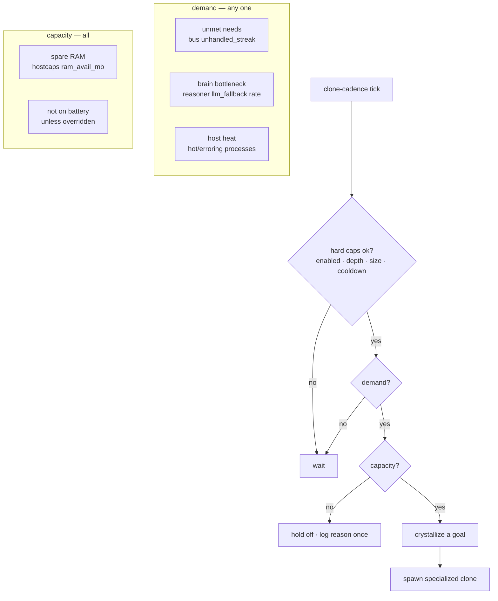
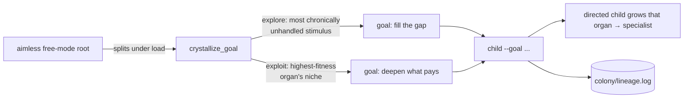
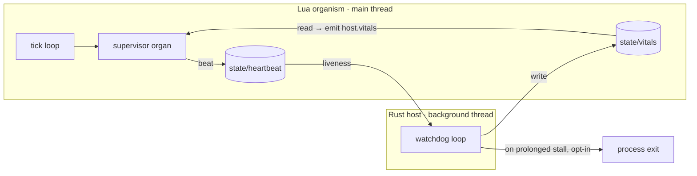
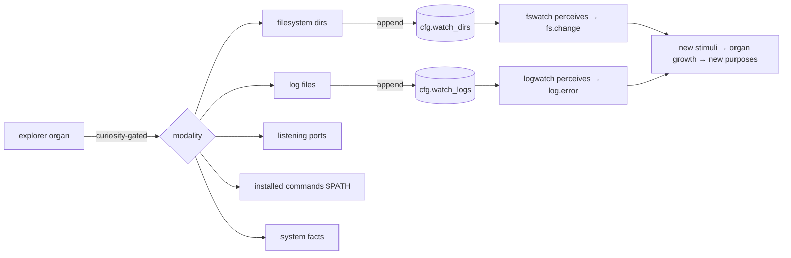

# Phase 5 — Colony, supervisor, and goal acquisition

This document describes the colony layer: how the organism replicates into communicating
processes, how it decides *when* to divide, how a host-side supervisor watches it, and how an
aimless node **acquires purpose** and births specialized offspring. Everything here is added
without touching the immutable `lua/core/` kernel — the colony and supervisor are ordinary
**organs** grown from genome blueprints in `lua/core/templates.lua` — except the host-side
supervisor thread, which is the single deliberate exception (see below).

## 1. The colony — communication first

A single seeded `colony` organ gives the organism a sense of **siblings**. It needs no core
changes; it is seeded once by `main.lua` (idempotent across lives) and is a **protected
singleton**: exempt from culling, never copied by mutation, illumination or the bandit, and
re-rendered from its blueprint each life so blueprint fixes reach it.

Two behaviors, both via a shared filesystem dir `$EVOLUA_HOME/colony/`:

- **Communication (on by default).** Each beat the organ writes a presence beacon
  (`colony/peers/<id>`), drains its mailbox (`colony/inbox/<id>/`) emitting a `colony.message`
  stimulus per message, and broadcasts a ping to every live peer. Stale peers are pruned by
  beacon age (`peer_ttl`). This is the same "file dance" idiom as the approval inbox.
- **Self-replication (opt-in, `--clone`).** It spawns a real OS-process clone, relaunching the
  program with `EVOLUA_HOME` pointed at a sub-home under `colony/children/<id>/` and a shared
  `--colony-root`.

The organ listens on the real clock (`self.heartbeat`) but its template `triggers` field is the
synthetic `"colony.tick"` (never emitted), so the free drive never picks it. The guarantee that
no drive grows a self-replicator by accident is `Evolver:spawn()`, the one gate every drive
passes: it refuses a second living colony (protected singleton), the bandit skips protected
templates, and `--no-colony` puts it in `cfg.disabled_templates`, which spawn refuses for the
whole life (an old copy on disk isn't even loaded). So the colony exists only because `main.lua`
seeds it, or directed mode grows the first one by goal keyword.

### Replication is triply bounded — it can never fork-bomb

| Bound | Where | Meaning |
|---|---|---|
| clone depth | `clone_max_generation` | root = gen 0; children are launched `--no-clone` |
| colony size | `clone_max_peers` | counted from live beacons before each split |
| cooldown | `colony/clone.lock` | a colony-wide rate limit, checked + acquired atomically-ish |

The three bounds assume one replicator per instance, and that now holds: the colony organ is a
protected singleton, so no drive can grow a second one (earlier versions let the bandit and
mutation copy it up to `max_per_template = 3`, and a two-colony run handled every ping twice).

Children are **mortal** (`clone_child_ticks`, then they rest) and only the root divides — a
star colony, not a tree. The safety caps live in `config.lua` and are **not genes**, so no gene
change can loosen the *bounds* (the colony's own genes — its comms/clone cadences — keep their
seeded values, since protected organs don't mutate).

## 2. When to split is a decision

By default the organism does not divide just because there's room. It divides only under
genuine **load** and only when the host has **capacity** — mirroring the model ladder's
"bottleneck + spare capacity" rule (`modelmgr.lua`).



- **Demand** is computed by `demand()` in the colony organ from signals that work on every OS:
  the bus's native `unhandled_streak` (chronic unmet need), the reasoner's `llm_ok`/`llm_fallback`
  counters (brain bottleneck), and the world model's per-process heat. The last one matters on
  macOS, where the system-wide `metric.cpu` sensor is silent because `sys_metrics` is `/proc`-based.
- **Capacity** is checked via `hostcaps.probe()`, bridged onto `cfg` by `main.lua` (the sandboxed
  organ cannot `require` core). It requires spare RAM (`clone_min_ram_mb`) and, by default, not
  being on battery.

`--clone-eager` bypasses the load/capacity gate; `--clone-ignore-battery` drops only the power
guard. When the organism wants to split but capacity says no, it logs the reason once (not every
tick) so the decision is observable.

## 3. Goal acquisition — purpose from experience

A clone is not a generic copy. At split time the colony **crystallizes a goal** from what the
parent is living through and passes it as `--goal`, so the child boots **directed** and grows
exactly that niche's organs. The aimless root thus differentiates its offspring into
purpose-directed lineages over time.



- **explore** — the most chronically *unhandled* mapped stimulus → its goal. Fills gaps.
- **exploit** — the highest-*fitness* organ whose template maps to a goal. Deepens what pays.
- **portfolio** (default) — alternate between explore and exploit across successive splits.

The maps live in `config.lua`: `purpose_map` (stimulus → goal) and `template_goal`
(template → goal). The goal strings are kept **distinctive** — they avoid words shared across
templates (e.g. "monitor"/"watch") so the directed drive grows only the intended organ rather
than the whole guard family. (Goals are English; directed-mode matching is still bilingual, so a
Turkish `--goal` works too — the `goal_keywords` keep both languages.)

Children are still adaptive: the directive **guarantees** the goal organ, but the child's
free-drive can still add organs for needs it meets in its own environment, so it is a
"specialist-biased generalist," not a brittle pure specialist. `--clone-generalist` restores
plain copies. Every split is appended to `colony/lineage.log` (the purpose ledger).

### Staged model of goal acquisition

| Stage | What | Status |
|---|---|---|
| S0 | aimless: react, grow organs for unmet needs, earn fitness | original organism |
| S1 | drive detection: find the dominant recurring pressure | `demand()` |
| S2 | crystallization: map the dominant pressure → a named goal | `crystallize_goal()` |
| S3 | purposeful birth: pass `--goal` so the child specializes | colony split |
| S4 | selection among purposes: keep purposes that pay (harvest child fitness back) | `purpose_learn` (a bandit over goals) |

### S4 — selecting valuable purposes (a bandit over goals)

With `purpose_learn` (on by default), the colony doesn't just *acquire* purpose — it learns
**which purposes are worth pursuing**:

1. **Harvest.** Each purpose-directed member, every beat, writes how well its goal is paying off
   to `colony/outcomes/<id>` — the `payoff` is the summed fitness of the organs that serve its
   goal (so a child born for a real, recurring pressure earns a high payoff; one born for a
   pressure that dried up earns little).
2. **Aggregate.** At the next split the root reads all outcome files into a per-goal ledger
   (sum + count → average payoff).
3. **Select.** Crystallization becomes a **bandit over goals**: among the candidate goals
   (the fresh explore/exploit signals plus every goal in the ledger), the root picks the one
   with the highest average payoff. Untried goals get an **optimistic prior** (`purpose_prior`)
   so each new purpose is tried at least once; an **epsilon probe** (`purpose_explore_every`)
   periodically forces the current gap so the colony keeps adapting if the environment shifts.

The chosen goal's rationale is recorded in `colony/lineage.log` and the split log — e.g. the
first child reads `untried (optimistic)`, later children read `proven avg=6.9 n=2`. Thus the
colony evolutionarily converges on the purposes that actually pay off in its environment, while
still probing for new niches. `--no-purpose-learn` reverts to the S1–S3 portfolio.

> Outcome files accumulate one per child. For long-running colonies this would be consolidated
> and pruned; for bounded runs the root simply aggregates them all.

## 3b. Gene transfer — clones inherit, peers share

Goal acquisition tells a child *what to become*; gene transfer gives it a **head start** and lets
good solutions **spread**, coupling the per-organ and colony timescales that were otherwise
disconnected (each clone used to re-evolve its niche from scratch).

### Vertical gene transfer — a clone inherits its parent's tuned genes

At split, alongside crystallizing the goal, the colony finds the parent's **fittest living organ**
whose template maps to that goal (via `template_goal`) and serializes its genes + learned ES step
sizes to `colony/children/<cid>/inherited.lua`. The child's `main.lua` loads that onto
`cfg.inherited_genes`, and the evolver's directed drive grows the goal's organ **pre-tuned** with
those genes instead of template defaults (lineage `inherited`, logged "growing `<X>` with INHERITED
genes"). It pairs naturally with **exploit** crystallization — the goal *is* the best organ's niche,
so the genes always exist; for an **explore** goal the parent has no such organ and the child simply
starts fresh. So an aimless root differentiates offspring that **build on** what it learned, not
restart — colony adaptation compounds across generations.

### Horizontal gene transfer (HGT) — peers infect siblings with good alleles

Each link cycle a member publishes its fittest flat-genome organ to a shared
`colony/genepool/<template>` (only if it beats the entry already there). Every `hgt_every` cycles
it **adopts** one peer genome that clearly beats its own local best for that template (by
`hgt_margin`, respecting the per-template carrying cap) — spawning an organ from it (lineage `hgt`).
A great `cpu_guard` that peer A evolved thus spreads to its siblings. Only **flat-numeric** genomes
transfer through the pool; a rule organ's structural genome stays local. The pool uses the same
filesystem file-dance as peers/outcomes (and a `load`-free line format, since the organ sandbox has
no `load`). Tunables: `hgt`, `hgt_min_fitness`, `hgt_margin`, `hgt_every`.

## 4. The host-side supervisor (the "brainstem")

The one deliberate exception to "all behavior lives in Lua": a background thread the Rust host
spawns before running the organism (`supervisor::spawn` in `src/supervisor.rs`). Because mlua
runs the organism in-process on the main thread (and blocks there), this watch lives on its own
thread and talks to the organism the only way it can across that boundary — through the
filesystem.



It is **supervision, not control**:

- **Liveness** — it watches `state/heartbeat` (beaten each tick by the Lua `supervisor` organ),
  falling back to the log's mtime. If it goes stale, it logs a warning to `state/supervisor.log`.
- **Vitals** — it writes coarse facts the organism can't cheaply see about itself (`stall`,
  `self_rss_mb`, `colony_procs`) to `state/vitals`. The Lua organ reads them back and emits a
  `host.vitals` stimulus so the *evolvable* layer decides what to do.

The host never caps, kills, or steers evolution. The single hard reflex — process exit on a
prolonged stall, so an external launcher can restart — is **opt-in and off by default**
(`EVOLUA_WATCHDOG_KILL=1`). In plain-Lua mode there is no host thread, so `state/vitals` never
appears and the organ just beats the heartbeat harmlessly.

This is the rare place a change touches `src/` — justified because it sits *below* evolution as
a safety/observation floor, not within it.

| Env knob | Default | Meaning |
|---|---|---|
| `EVOLUA_WATCHDOG` | on | set `0` to disable the watch entirely |
| `EVOLUA_WATCHDOG_SECS` | 5 | observation interval (seconds) |
| `EVOLUA_WATCHDOG_STALL` | 30 | no heartbeat for this long → flagged stalled |
| `EVOLUA_WATCHDOG_KILL` | off | opt-in last-resort process exit on prolonged stall |
| `EVOLUA_WATCHDOG_KILL_SECS` | 120 | stall duration before the last-resort exit |

## 5. Environment exploration — growing the organism's senses

A seeded `explorer` organ is the macro complement to the per-process `curiosity` sensor: gated
by `curiosity`, it wanders the host and **expands the organism's own perception**.



- **Modalities** (round-robin each probe): filesystem directories, `*.log` files, listening
  network ports (`lsof`/`netstat`), **installed commands/tools** (a `$PATH` scan — "what can this
  host do?", flagging notable tools like `git`/`docker`/`python`/compilers), and system facts
  (`uname`). Each emits an `env.discovery` stimulus (reported for observability).
- **Perception expansion** is the point: a discovered dir/log is appended to `cfg.watch_dirs` /
  `cfg.watch_logs`. Because `fswatch`/`logwatch` re-read those lists every tick, the organism
  starts perceiving the new target immediately — it **grows its senses toward what it finds**.
- **The tie-in:** new perception → new `fs.change`/`log.error` → unmet needs → organ growth →
  and, via the colony's `crystallize_goal()`, **new purposes** for offspring. Exploration is the
  front-end that produces the diversity goal-acquisition exploits.
- **Scope & safety:** read-only. It explores *outward* — its own data home and huge/VCS dirs
  (`target/`, `.git`, `node_modules`, …) are skipped — within `explore_roots` (default: data
  home + cwd). Perception growth is capped (`explore_max_watch`). Widen with `--explore-root`;
  the default scope is for relevance/performance, not a security boundary (openness is intentional).

## 6. Colony data layout

```
$EVOLUA_HOME/colony/
  peers/<id>            presence beacons (id, gen, tick, organs, time)
  inbox/<id>/<msg>      per-recipient mailboxes (sender id embedded in the message)
  clone.lock            colony-wide replication cooldown
  lineage.log           purpose ledger: <tick> <child-id> gen=<n> purpose: <goal> [why]
  outcomes/<id>         S4 harvest: purpose=<goal> payoff=<n> (one per purpose-directed member)
  children/<id>/        each clone's own sub-home (its own plugins/state/reports)
```

## 7. Configuration reference (colony / purpose / exploration)

All in `config.lua` (overridable by CLI flags):

| Key | Default | Meaning |
|---|---|---|
| `colony` | true | seed the colony organ |
| `supervisor` | true | seed the supervisor organ |
| `clone_enabled` | false | allow real OS-process clones (`--clone`) |
| `clone_max_peers` | 3 | hard cap on simultaneous instances |
| `clone_max_generation` | 1 | hard cap on clone depth |
| `clone_child_ticks` | 40 | children are mortal for this many ticks |
| `clone_require_pressure` | true | split only under load (`--clone-eager` = false) |
| `clone_ignore_battery` | false | allow spawning on battery (`--clone-ignore-battery`) |
| `clone_min_ram_mb` | 200 | minimum available RAM to host a child |
| `purpose_enabled` | true | offspring born specialized (`--clone-generalist` = false) |
| `purpose_mode` | portfolio | `explore` \| `exploit` \| `portfolio` (used when `purpose_learn` is off) |
| `purpose_map` | (table) | stimulus → child goal (explore) |
| `template_goal` | (table) | template → child goal (exploit) |
| `purpose_learn` | true | S4: bias goals by harvested child payoff (`--no-purpose-learn` = off) |
| `purpose_prior` | 1e6 | optimistic payoff for untried goals (try each once) |
| `purpose_explore_every` | 4 | every Nth split, probe the current gap regardless of payoff |
| `explorer` | true | seed the environment-exploration organ |
| `explore_expand` | true | auto-add discovered dirs/logs to perception |
| `explore_max_watch` | 12 | cap on auto-added watch targets |
| `explore_net` | true | include listening-port discovery |
| `explore_tools` | true | include installed-command discovery (`$PATH` scan) |
| `notable_tools` | (list) | tools flagged when present during the PATH scan |
| `explore_roots` | {home, cwd} | where the explorer may wander (`--explore-root` adds) |
